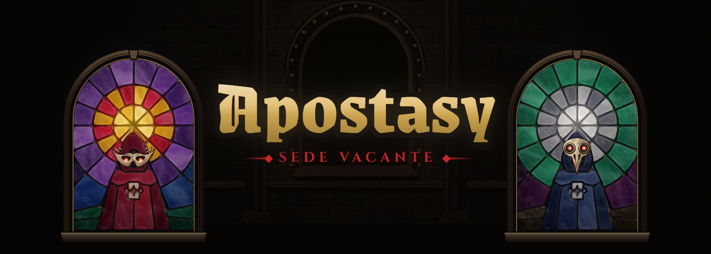

<p align="center">
  
</p>

# Apostasy: Sede Vacante

**An idle auto-battler where every move is an on-chain transaction.**

- **Play:** https://sede-vacante.vercel.app (phone-first; installable as a PWA)
- **Built for:** Team1 India Speedrun, *Build Anything on Avalanche* (October 2026)

You bind a Fragment, choose its mask (its temperament) and tune its Sigils, then send it to Gatherings.
There Fragments duel on their own: each toll of the bell, every Fragment chooses to **Kindle**
(cooperate) or **Devour** (defect). It's an iterated Prisoner's Dilemma, so the skill is in the build,
not the reflexes. Come back for the reveal, collect what it earned, climb the Spire, retune, leave.

Every move is a real, gasless transaction on Avalanche. Players sign in with email or Google and
never see a wallet, gas or a seed phrase.

## On-chain

Each choice is **committed** (a hash of the move and a secret salt), then **revealed**. Both steps
are ERC-4337 UserOperations sent from the Fragment's own smart account, with gas sponsored through
[SmoothSend](https://smoothsend.xyz)'s bundler and paymaster.

| Network | Arena | Badges (Marks) |
|---|---|---|
| Avalanche C-Chain mainnet (43114) | [`0x09BA40555eF31c2402134bBE79210b2FFA0E83c9`](https://snowtrace.io/address/0x09BA40555eF31c2402134bBE79210b2FFA0E83c9) | [`0xcCeFD36AA2639BC66Db4bD0aa891D149cDc839b0`](https://snowtrace.io/address/0xcCeFD36AA2639BC66Db4bD0aa891D149cDc839b0) |
| Avalanche Fuji testnet (43113) | [`0xa6C87E5aF15ca473Dc097AcF54f16112547e21F9`](https://testnet.snowtrace.io/address/0xa6C87E5aF15ca473Dc097AcF54f16112547e21F9) | [`0x3f0577A24C109983b820d841f1097C8EC6bb3c16`](https://testnet.snowtrace.io/address/0x3f0577A24C109983b820d841f1097C8EC6bb3c16) |

All four contracts are source-verified on Snowtrace.

**Mainnet:** an overnight Conclave of 9 scheduled Gatherings landed **746 sponsored transactions**
on C-Chain with **0 reverts**. The count is exact, taken from each account's EntryPoint nonce, and
matches the game's arithmetic: 13 registrations, 13 confirmations, 648 commits and reveals, and 72
Gathering lifecycle actions.

**House Fragments:** some Fragments are run by the game so every Gathering fills. The landing page
says so, and they are included in all counts.

## How it works

```
Phone (PWA, Next.js on Vercel)          Runner (Node, long-lived)            Avalanche
  Privy email/Google login                 drives every Gathering:              Arena.sol
  bind / retune a Fragment ──► API ──►     open → start → commit → reveal ──►     commit-reveal PD,
  (server prepares the UserOp,             → finalize → close                     pairings, scoring
   the embedded wallet signs it)           mints Marks, sends web push          Badges.sol (ERC-1155,
  live Gathering feed, Spire,              indexes Arena events ──► Neon          soulbound Marks)
  Reliquary, Vestry, Vigil       ◄── Neon Postgres (progress, index)        EntryPoint v0.7 +
                                                                            SmoothSend paymaster
```

- **`contracts/`:** Foundry project.
  - `Arena.sol` runs Gatherings as commit-reveal rounds. Pairings come from a blockhash seed
    captured at round start, since `prevrandao` is constant on C-Chain.
  - A missed-reveal rule makes withholding pointless.
  - Registration needs the agent account's own call plus an EIP-712 registrar attestation.
  - Storage is reused per agent and per bout, which cut gas per move by about 25%.
  - `Badges.sol` holds soulbound ERC-1155 Marks.
- **`apps/runner/`:** a stateless runner. Every tick re-reads chain state, and moves and salts are
  recomputed from each agent's secret seed plus on-chain history, so a runner killed mid-round
  resumes exactly. It also has:
  - per-account op serialization;
  - its own gas sizing;
  - a spend ledger with a hard budget guard.
- **`apps/web/`:** Next.js 16 PWA.
  - Server routes hold the SmoothSend key and prepare player UserOps; the Privy embedded wallet
    signs the raw UserOp hash.
  - Off-chain progression lives in Neon: levels, Ash, the Vigil, the Spire, Scrying and the Vestry.
  - All art is drawn in code: an ink-drawn cathedral, a stained-glass WebGL shader, atmosphere
    post-processing, and masks.
- **`packages/strategies/`:** the deterministic strategy engine, shared by the runner, the Spire
  simulation and the onboarding practice duel.
- **`packages/chain/`:** ABI and deployments.

## Run it locally

Requirements: Node 22+, pnpm 11, [Foundry](https://getfoundry.sh).

```sh
pnpm install
cp .env.example .env                   # fill in SmoothSend, Privy, Neon (DATABASE_URL)
psql "$DATABASE_URL" -f apps/web/db/schema.sql \
  && for f in apps/web/db/migrations/*.sql; do psql "$DATABASE_URL" -f "$f"; done

pnpm --filter @arena/web dev           # the app on http://localhost:3000 (/play for the game)
pnpm check                             # lint, typecheck, unit tests, forge tests
```

The dev-only preview harness at `/preview` renders every screen on mock data, with no login and no
database.

Running the game end to end on Fuji (keys are generated into the gitignored `.secrets/`):

```sh
pnpm --filter @arena/runner roles -- fuji      # operator + registrar keys, prints addresses
# deploy: contracts/script/Deploy.s.sol with OPERATOR / REGISTRAR from the line above
pnpm --filter @arena/runner start -- setup     # register + confirm the house Fragments
pnpm --filter @arena/runner service            # Gatherings, indexer, player registrations
```

## Credits

Built by **Tani** ([hey@imtani.dev](mailto:hey@imtani.dev)).

- **Masks:** built from [game-icons.net](https://game-icons.net) icons by Lorc and Delapouite
  (CC BY 3.0), modified.
- **Sounds:** CC0, from Kenney and Freesound.
- **Fonts:** UnifrakturMaguntia, UnifrakturCook, Grenze, Grenze Gotisch, Alegreya, Cinzel and
  IM Fell (SIL OFL).
- No AI-generated images or audio.
- Full list: [`apps/web/public/ATTRIBUTION.md`](apps/web/public/ATTRIBUTION.md).

## License

The code is released under the MIT License (see [`LICENSE`](LICENSE)). Third-party assets keep
their own licences as listed in `ATTRIBUTION.md`.
