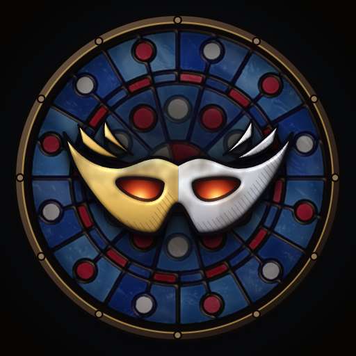
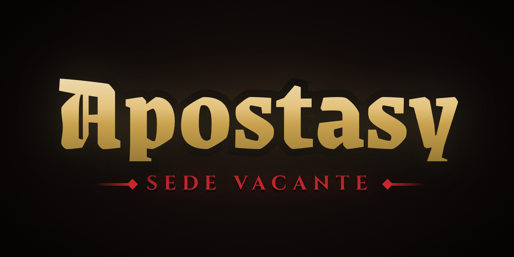
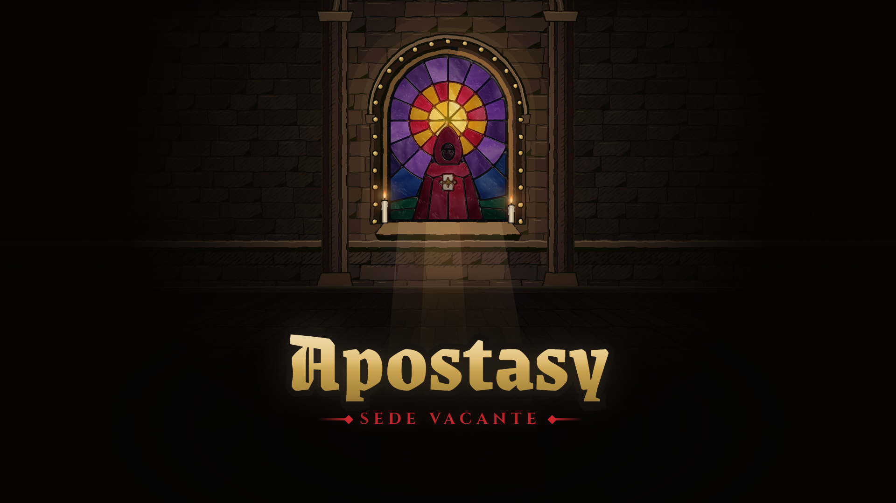
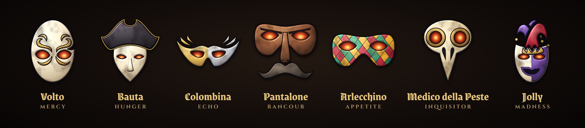

# Apostasy: Sede Vacante: brand sheet

A god devoured itself. What is left of it is ink, stone, old gold and dried blood, lit from
behind by stained glass. **The glass is the only saturated colour in the world.**

Every image here was rendered from the game's own code-drawn art (the mask set, the
stained-glass shader, the ink nave, the title lettering) or captured from the running app.
None of it was made by an AI image generator. Rebuild steps are at the end of this sheet.

## Files

### Logo

| File | What it is | Use it for |
| --- | --- | --- |
| `logo-512.png` | The rose and mask on the ink plate, 512 x 512 (290 KB) | Listing logo, avatars |
| `logo-1024.png` | The same at 1024 x 1024 | Print, press, large placements |
| `logo-transparent-1024.png` | No plate: the rose and its halo on transparency | Over dark art and video |
| `logo.svg` | Flat vector version (the rose's SVG art without the shader light) | Favicon, anywhere a vector is needed |
| `logo-maskable.svg` | Flat vector, rose inside the 80% safe circle | Maskable icon source |
| `icons/icon-192.png`, `icons/icon-512.png` | PWA icons (also in `apps/web/public/`) | Web app manifest |
| `icons/icon-maskable-512.png` | Maskable PWA icon, rose inside the safe circle | Android adaptive icon |
| `icons/apple-touch-icon-180.png` | 180 x 180 | iOS home screen (not wired yet: `app/layout.tsx` still points `apple` at `/icon.svg`) |



**The mark:** Colombina, the Echo mask (gilded, ember eyes), set in the Fragment picker's
rose window in Echo's glass (blue, bone and ruby), with a stone moulding and gilt hairline.
Echo is the mask on the share card and on the landing hero, so the logo matches them.

### Wordmark

| File | Size |
| --- | --- |
| `wordmark-stacked-dark@2x.png` | 1600 x 800 |
| `wordmark-stacked-transparent@2x.png` | 1600 x 800, transparent |
| `wordmark-horizontal-dark@2x.png` | 2400 x 480 |
| `wordmark-horizontal-transparent@2x.png` | 2400 x 480, transparent |



This is the title-screen lettering. **Apostasy** is set in Grenze Gotisch 900, gilded (bone-hi to
gilt-l to gilt to gilt-d, top to bottom), cut into a thick soot outline with a cast shadow.
**SEDE VACANTE** is set in Cinzel 700, blood-l, tracked +0.3em, between two blood rules with
diamond terminals. In the stacked lockup the rubric's cap height is 0.185 of the name size.

### Key art and mask set

| File | Size | Use it for |
| --- | --- | --- |
| `keyart-1920x1080.png` | 1920 x 1080 | Video title card, slides, press kit |
| `keyart-clean-1920x1080.png` | 1920 x 1080 | The same nave without lettering (put your own text over the floor) |
| `masks-row.png` | 3080 x 680 | The seven masks with their names and Aspects |





### Listing (`../listing/`)

| File | Size | Caption (alt text in brackets) |
| --- | --- | --- |
| `cover-840x300.png` | 840 x 300 | Cover: Echo and Inquisitor Fragments face off in lit windows, the name between them. Nothing important sits in the outer 60 px. |
| `cover-1680x600@2x.png` | 1680 x 600 | The same at 2x |
| `screenshots/01-gathering.png` | 1080 x 1920 | "Your Fragment fights while you're away" (A Gathering verdict: Old Marrow devours Gallow) |
| `screenshots/02-collect.png` | 1080 x 1920 | "Collect what it earned" (A full Vigil with Collect, the Sigils and the Marks shelf) |
| `screenshots/03-practice.png` | 1080 x 1920 | "Learn by playing" (The practice duel: both Fragments kindle and share Light) |
| `screenshots/04-spire.png` | 1080 x 1920 | "Climb the Spire" (The Spire's five floors with two cleared and floor III open) |
| `screenshots/05-reliquary.png` | 1080 x 1920 | "Scry for cosmetics" (A Relic revealed in the Reliquary: the Pyre tint) |
| `screenshots/raw/*.png` | 780 x 1688 | The unframed phone captures (390 x 844 at 2x) |

## Palette

The palette tokens are in `apps/web/app/globals.css`. Ink and stone make up most of every
frame. Gilt is for names and reward. Blood is for the rubric, the main buttons and Devour.
Ember is for the eyes and heat.

| Token | Hex | Name / role |
| --- | --- | --- |
| `--c-void` | `#050403` | Void: page background, the darkest dark |
| `--c-soot` | `#0b0807` | Soot: ink lines, outlines, cast shadows |
| `--c-soot-2` | `#120c0a` | Soot 2: raised dark panels |
| `--c-stone` | `#1a1210` | Stone: cards, plates |
| `--c-umber-d` | `#241912` | Dark umber: panel gradients |
| `--c-umber` | `#3a2c22` | Umber: borders, chamfers |
| `--c-umber-l` | `#5a4632` | Light umber: lit stone |
| `--c-bone` | `#d8c6a0` | Bone: body text |
| `--c-bone-d` | `#a8916a` | Dark bone: secondary text |
| `--c-bone-dd` | `#6e5c46` | Deep bone: disabled, hairlines |
| `--c-bone-hi` | `#f3e6c8` | Bright bone: headings, highlights |
| `--c-blood-dd` | `#3a0709` | Deep blood: shadows under red |
| `--c-blood` | `#8e1218` | Blood: main buttons |
| `--c-blood-l` | `#c7262c` | Light blood: the SEDE VACANTE rubric, Devour |
| `--c-ember-d` | `#7a1c0e` | Dark ember: the outer glow of the eyes |
| `--c-ember` | `#ff6a4a` | Ember: the eyes, heat, Full |
| `--c-ember-hi` | `#ffb27a` | Bright ember: the core of the eyes |
| `--c-gilt-d` | `#9a7a35` | Dark gilt: the foot of the gilded name |
| `--c-gilt` | `#c9a24f` | Gilt: frames, rules, the stone hairline |
| `--c-gilt-l` | `#e3c27c` | Light gilt: links, rubrics, names |
| `--c-gilt-hi` | `#f5dfa0` | Bright gilt: shine |

**Glass (one main colour per Aspect, `ASPECT_GLASS` in `src/ui/GlassWindow.tsx`).** Use these only
as light through glass, never as flat fills for UI.

| Aspect (mask) | Glass | Second | Third |
| --- | --- | --- | --- |
| Mercy (Volto) | `#e8c46a` | `#f3e6c8` | `#c9a24e` |
| Hunger (Bauta) | `#8e1218` | `#c7262c` | `#4a0a0e` |
| Echo (Colombina) | `#2c5fa8` | `#c9ccd4` | `#1d3f8f` |
| Rancour (Pantalone) | `#6b3b2a` | `#a3172f` | `#3a1f15` |
| Appetite (Arlecchino) | `#176a4f` | `#d9951f` | `#a3172f` |
| Inquisitor (Medico della Peste) | `#1d3f8f` | `#e2d6bf` | `#2b6f6a` |
| Madness (Jolly) | `#5b2a7a` | `#d9951f` | `#176a4f` |

## Type

All five faces are under the SIL Open Font License 1.1 and are served from our own origin through
`next/font` (`apps/web/app/fonts.ts`).

| Face | Role | Where it is used |
| --- | --- | --- |
| **Grenze Gotisch** (900 for the name, 700 for headings) | Display | The name, screen titles, Fragment names, button labels. Blackletter on Roman bones: it stays readable when set large. |
| **Grenze** (roman, 700) | Readable display | Gathering verdicts, name plates, the listing captions. Use it when a heading must read at a glance. |
| **Cinzel** (700) | Rubrics and numbers | Small-caps labels tracked +0.16 to 0.3em, Light counts, SEDE VACANTE. Always uppercase. |
| **Alegreya** (400 to 700, italic) | Text | Running text, hints, the feed, consent lines (13 to 18 px on a phone). |
| **IM Fell English** (400, italic) | Book | Epithets and italic subtext, where letterpress grit fits. |

Rules: never set Grenze Gotisch in all caps, and never use it for running text. Cinzel is only
for short labels. Set text on soot or umber, and put a 1 to 2 px soot shadow under light text that
sits on art.

## Logo usage

- **Clear space:** keep a margin of at least **1/8 of the logo's width** on every side, free of
  text and other marks. For the wordmarks, keep at least the height of the "A" of Apostasy.
- **Minimum size:** logo **32 px** on screen (16 px favicon only as `logo.svg`); the mask must
  still read. For the shader PNGs, use 64 px or larger.
  Stacked wordmark **200 px** wide (the rubric falls below 9 px under that); horizontal wordmark
  **320 px** wide. Below these sizes, set "Apostasy" alone in Grenze Gotisch.
- **Backgrounds:** use void, soot or the game's own dark art. On light or busy backgrounds, use
  `logo-512.png` / `logo-1024.png` (with their ink plate) or the dark wordmark plates, not the
  transparent files.

**Do**
- Use the files as delivered, scaled in proportion.
- Pair the logo with the stacked wordmark below it, or with the horizontal wordmark to its right.
- Let the glass be the only saturated colour near the mark.

**Don't**
- Recolour the glass, the gilt or the ember eyes, or swap in another mask.
- Stretch, skew, rotate, outline, bevel or add glow effects to the mark or the lettering.
- Set the name in another face, or rebuild the lettering without the soot cut and the gilt.
- Put the transparent files on light backgrounds (the halo and soot cut are made for the dark).
- Make new art for the brand with AI image tools. Every visual comes from the game's code or
  real captures of it.

## Credits (for press kits)

- **Masks:** built from icons on [game-icons.net](https://game-icons.net) by **Lorc** and
  **Delapouite**, licensed [CC BY 3.0](https://creativecommons.org/licenses/by/3.0/). We split,
  recombined, recoloured and shaded them in code. The icon authors do not endorse this game.
  The full table is in `apps/web/public/ATTRIBUTION.md`.
- **Fonts:** Grenze Gotisch and Grenze (Omnibus-Type), Cinzel (Natanael Gama), Alegreya
  (Huerta Tipográfica), IM Fell English (Igino Marini), all SIL OFL 1.1.
- **Everything else** (the rose and arched windows, the glass shader, the ink nave, the
  lettering treatment) is the game's own code-drawn art.

Suggested credit line: *Masks adapted from game-icons.net icons by Lorc and Delapouite
(CC BY 3.0).*

## Rebuilding

The assets come from dev-only pages in the web app: `/_brand` (folder
`apps/web/app/%5Fbrand/`, which returns 404 in production) and `/preview` for the phone captures.

```
# apps/web: the dev server
pnpm --filter @arena/web exec next dev -p 3200
# one headless Chromium for every capture (needs Playwright on NODE_PATH)
NODE_PATH=<dir>/node_modules node submission/brand/tools/capture-server.cjs 3299
# all assets, or one group: logo wordmark cover key masks shots frames icons
bash submission/brand/tools/render-all.sh [group]
node submission/brand/tools/verify.cjs     # sizes and byte limits
curl -s localhost:3299/quit                # close the browser
```

Copy `icons/icon-192.png`, `icons/icon-512.png` and `icons/icon-maskable-512.png` into
`apps/web/public/`, and `logo.svg` / `logo-maskable.svg` over `public/icon.svg` /
`public/icon-maskable.svg`, if the logo changes.
